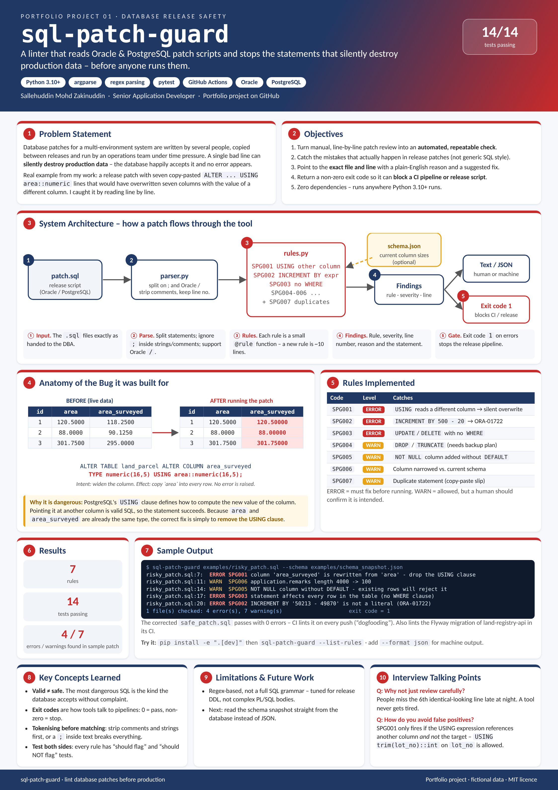

# sql-patch-guard


| [How to use](docs/USAGE.md) | [Design document](docs/DESIGN.md) | [Poster (PDF, A3)](docs/poster.pdf) | [Changelog](CHANGELOG.md) |
|---|---|---|---|

<a href="docs/poster.png"></a>

A small, dependency-free linter that reads Oracle / PostgreSQL patch scripts and flags statements that should
never reach production unreviewed.

## Why I built this

In my day job I review and run DDL patches across multiple Oracle and PostgreSQL environments for a government
land administration system. One release patch contained seven copy-pasted lines like this:

```sql
ALTER TABLE land_parcel ALTER COLUMN area_surveyed TYPE numeric(16,5) USING area::numeric(16,5);
```

The intent was "widen the column". The actual effect is "overwrite every row of `area_surveyed` with the value of
`area`" - silent, irreversible data loss. I caught it in a line-by-line review. This tool turns that review (and a
few other lessons learned the hard way) into an automated check that can run in CI or before a release.

*Table and column names in this repo are fictional.*

## Rules

| Code   | Severity | What it catches |
|--------|----------|-----------------|
| SPG001 | ERROR | `ALTER COLUMN x TYPE ... USING y` where the USING expression reads a **different** column |
| SPG002 | ERROR | `ALTER SEQUENCE ... INCREMENT BY 500 - 20` - Oracle needs a literal (ORA-01722) |
| SPG003 | ERROR | `UPDATE` / `DELETE` with no `WHERE` clause |
| SPG004 | WARN  | `DROP TABLE`, `TRUNCATE`, `DROP COLUMN/CONSTRAINT` |
| SPG005 | WARN  | `ADD COLUMN ... NOT NULL` without `DEFAULT` (fails on tables with data) |
| SPG006 | WARN  | Column narrowing vs. a schema snapshot (`varchar(4000)` -> `varchar(100)`, fewer integer digits) |
| SPG007 | WARN  | Exact duplicate statement in the same file |

## Usage

```bash
pip install -e ".[dev]"

sql-patch-guard examples/risky_patch.sql --schema examples/schema_snapshot.json
sql-patch-guard patches/*.sql --format json --fail-on warn
sql-patch-guard --list-rules
```

Sample output:

```
examples/risky_patch.sql:7: ERROR SPG001 column 'area_surveyed' is rewritten from 'area' - every row will be
    overwritten with another column's value. If only the type/size changes, drop the USING clause.
examples/risky_patch.sql:20: ERROR SPG002 INCREMENT BY '50213 - 49870' is not a literal - pre-calculate the gap
examples/risky_patch.sql:11: WARN SPG006 application.remarks length 4000 -> 100.

1 file(s) checked: 4 error(s), 7 warning(s)
```

Exit code is `1` when errors are found, so it can gate a CI pipeline or a release script.

### Schema snapshot (optional)

SPG006 needs current column sizes. Export them from the target database into JSON:

```json
{ "application": { "remarks": { "type": "varchar", "length": 4000 } },
  "land_parcel": { "area": { "type": "numeric", "precision": 16, "scale": 4 } } }
```

PostgreSQL source query:

```sql
SELECT table_name, column_name, data_type, character_maximum_length, numeric_precision, numeric_scale
FROM information_schema.columns WHERE table_schema = 'public';
```

## How it works

- `parser.py` - splits a script into statements, ignoring `;` inside strings and comments, supports the Oracle
  `/` terminator, and keeps the original line number for each statement.
- `rules.py` - each rule is a small function registered with a decorator, so adding a rule is ~10 lines.
- `linter.py` - runs every rule over every statement and adds file-level checks (duplicates).

## Limitations

Regex-based, not a full SQL grammar. It is tuned to have few false positives on the kind of DDL found in
release patches, not to understand arbitrary PL/SQL.

## License

MIT
