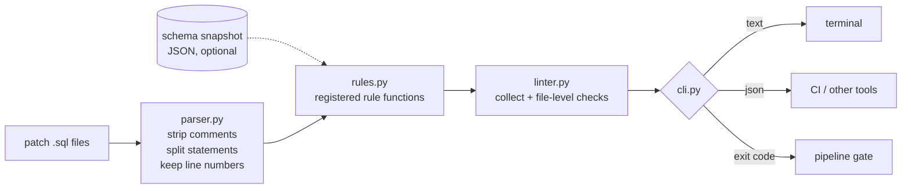

# sql-patch-guard: Design document

| | |
|---|---|
| Author | Sallehuddin Mohd Zakinuddin |
| Status | v1.0.0 implemented |
| Last updated | November 2026 |

## 1. Context

Database changes for a multi-environment system ship as SQL patch files. They are written by several developers,
copied between releases, and executed by an operations team, often in a night maintenance window. Review is manual
and line by line.

The incident that started this project: a release patch widened seven numeric columns with statements like

```sql
ALTER TABLE land_parcel ALTER COLUMN area_surveyed TYPE numeric(16,5) USING area::numeric(16,5);
```

PostgreSQL accepts this. The `USING` clause tells it how to compute each new value, and it was copied from the
`area` line, so every row of `area_surveyed` would have been overwritten with `area`. No error, no warning, no undo.
It was caught by a careful human review. The goal is to make that catch automatic.

## 2. Goals and non-goals

**Goals**

1. Flag the specific statement patterns that have caused or nearly caused production data loss or failed releases.
2. Report the exact file and line with a plain-language reason and a fix hint.
3. Gate pipelines: a non-zero exit code when errors are present.
4. Run anywhere with no dependencies (ops servers often have no internet access for `pip install`).
5. Keep false positives low enough that people do not learn to ignore the tool.

**Non-goals**

- A full SQL parser or formatter.
- Style rules (casing, indentation).
- Understanding PL/SQL package bodies.
- Executing anything against a database.

## 3. Requirements

| ID | Requirement |
|---|---|
| R1 | Split a script into statements, ignoring `;` inside string literals and comments |
| R2 | Support Oracle's `/` statement terminator |
| R3 | Keep the source line number of each statement |
| R4 | Each rule is independent and individually disableable |
| R5 | Optional schema snapshot for checks that depend on current column sizes |
| R6 | Text output for people, JSON output for tools |
| R7 | Configurable failure threshold (`error`, `warn`, `never`) |

## 4. Architecture



### Components

| Module | Responsibility |
|---|---|
| `parser.py` | `_strip_comments` removes `--` and `/* */` comments outside quotes, replacing block comments with the same number of newlines so line numbers stay correct. `split_statements` walks the text character by character, tracking quote state, and yields `Statement(text, raw, line)`. |
| `rules.py` | Each rule is a function `(Statement, schema) -> Iterable[Finding]` registered with `@rule(code, description)`. Rules use anchored regular expressions over the normalised statement text. |
| `linter.py` | Runs every enabled rule on every statement, then adds the file-level SPG007 duplicate check, and sorts findings by line. |
| `cli.py` | Argument parsing, output formatting, exit codes. |

### Data model

```python
Statement(text: str, raw: str, line: int)        # text = whitespace-collapsed, comments removed
Finding(rule: str, severity: "ERROR"|"WARN", line: int, message: str, statement: str)
Schema = {table: {column: {"type", "length" | "precision", "scale"}}}
```

## 5. Rule design

| Code | Detection approach | Why this severity |
|---|---|---|
| SPG001 | Match `ALTER TABLE t ALTER COLUMN c TYPE … USING expr`. Remove string literals and `::type` casts from `expr`, collect identifiers, drop SQL keywords and function names. Fire if identifiers remain that are not `c`, and `c` itself is absent. | ERROR: silent, irreversible overwrite |
| SPG002 | `ALTER SEQUENCE … INCREMENT BY x` where `x` is not a signed integer literal | ERROR: Oracle raises ORA-01722 mid-release |
| SPG003 | Statement starts with `UPDATE` or `DELETE` and has no `WHERE` | ERROR: touches every row |
| SPG004 | `DROP TABLE`, `TRUNCATE`, `DROP COLUMN/CONSTRAINT` | WARN: often intended, but needs a rollback plan |
| SPG005 | `ADD [COLUMN] … NOT NULL` without `DEFAULT` | WARN: fails on non-empty tables in most engines |
| SPG006 | New `varchar(n)` or `numeric(p,s)` compared with the snapshot. Numeric compares integer digits `p - s` and scale separately. | WARN: may truncate or reject data, but sometimes intended |
| SPG007 | Exact duplicate normalised statement in one file | WARN: usually a copy-paste slip |

### Why SPG001 checks "target column absent" as well

`USING trim(lot_no)::integer` on column `lot_no` is a legitimate conversion. Requiring the target column to be
missing from the expression keeps this case silent. The trade-off: `USING coalesce(lot_no, other_col)` is not flagged.
That pattern is rare in release patches and was accepted to keep false positives near zero.

### Why numeric narrowing compares integer digits

`numeric(16,4)` → `numeric(16,5)` looks like a widening but actually reduces the integer part from 12 to 11 digits.
A value of `123456789012.5` fits the old column and fails the new one. Comparing `precision - scale` catches this.

## 6. Key decisions

| Decision | Alternatives considered | Reason |
|---|---|---|
| Regular expressions over a hand-written splitter | Full SQL grammar (sqlglot, ANTLR) | Zero dependencies, works on Oracle and PostgreSQL dialects together, and release DDL is a small, regular subset of SQL |
| Rules registered by decorator | Class hierarchy, config file | A new rule is one function; no framework to learn |
| Schema snapshot as JSON | Live database connection | Linting runs in CI and on laptops with no database access; the snapshot can be exported once per release |
| Exit code 1 only on errors by default | Fail on any finding | Warnings need judgement; failing on them would push teams to disable the tool |
| Collapse whitespace in `Statement.text` | Match on raw text | Rules stay simple and are not fooled by line breaks inside a statement |

## 7. Testing strategy

- **Per rule:** at least one input that must be flagged and one that must not (`tests/test_rules.py`).
- **Parser:** comments containing `;`, strings containing `;`, Oracle `/` terminator, line number tracking.
- **End to end:** `examples/risky_patch.sql` must produce errors and exit 1; `examples/safe_patch.sql` must exit 0.
- **CI:** tests on Python 3.10 and 3.12, then the tool lints its own safe example ("dogfooding").

## 8. Limitations

- The splitter treats every `;` as a statement end, so PL/SQL bodies are split. Keep packages in separate files.
- Dynamic SQL (`EXECUTE IMMEDIATE '…'`) is not inspected.
- SPG006 only covers `varchar`/`varchar2` length and `numeric`/`number` precision and scale.

## 9. Future work

1. Read the schema snapshot directly from a database connection string.
2. Inline suppression comments, e.g. `-- spg:ignore SPG004`.
3. A rule for `CREATE INDEX` without `CONCURRENTLY` on large PostgreSQL tables.
4. Publish as a reusable GitHub Action and pre-commit hook.
